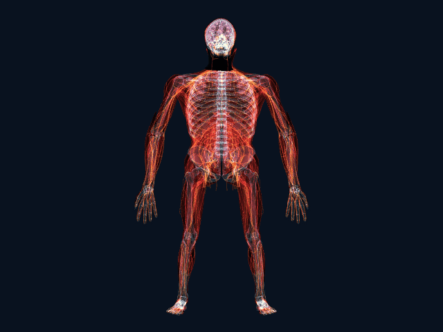

# 3D anatomy camera

[](https://github.com/keanu77/3D_anatomy_camera/actions/workflows/ci.yml)

Point a camera at yourself and a 3D skeleton, muscles and nerves follow your head, hands and body, in the browser. It is for learning anatomy; nothing is uploaded.

[**Open the app**](https://3danatomycamera.sportsmedicine.tw/) · [**Try the demo, no camera needed**](https://3danatomycamera.sportsmedicine.tw/#demo) · [繁體中文說明](README.zh-TW.md) · [Changes](CHANGELOG.md)



An independently built, browser-based anatomy viewer by **吳易澄** ([sportsmedicine.tw](https://sportsmedicine.tw/)). Video and tracking landmarks stay on the device. The app has no analytics or image upload, and its runtime assets are served from the same origin.

## Features

- Explore skeletal, muscle, neural and selected organ layers in X-ray or solid view.
- Track head, hands and body with MediaPipe; preview synthetic poses without a camera.
- Pick exact source surfaces, inspect overlapping structures, and read source-linked names and reference text.
- Focus a body region and anatomical side, with readable Traditional Chinese or English labels.
- Use the interface in Traditional Chinese or English. It follows the browser language, the button in the header changes it, and a link can ask for one with `?lang=en` or `?lang=zh`.
- Pause, rotate, pinch or wheel to zoom; adjust brightness, feathering, reveal planes and the fingertip lens.
- Use responsive desktop/mobile controls, local background inference and lazy-loaded anatomy bundles.

## Run locally

Node.js **22.12 or newer** is required (CI uses Node 24).

```sh
npm ci
npm run build
npm run dev
```

The first build downloads the existing pinned tracking models and verifies their SHA-256 hashes. WASM comes from the locked MediaPipe package. Verified cached models are reused. Open the HTTPS URL printed by Vite; camera access starts only after selecting **啟動鏡頭**. **先看示範** works without camera permission.

Useful demo routes:

```text
/?still#demo
/#demo&systems
/?still#demo&nervous
/#demo&focus=shoulder
```

To run the complete checks:

```sh
npx playwright install chromium
npm run check
```

Checks cover numerical coordinate/frame contracts, immutable source assets, source-triangle picking, six independent visual snapshots, mobile layouts, pause/orbit/zoom, loader cancellation, security headers, workers and actual installed tracking models. Browser tests start local servers on ports 4173 and 4174. Emulation is not physical-device validation.

The production output is the static `dist/` directory. Headers in `public/_headers` must also be configured on any alternate host. For a subpath, build with `BASE_PATH=/your-path/ npm run build`.

## Data, provenance and licenses

Project-authored code is **MIT**, Copyright (c) **2026 吳易澄**; see [LICENSE](LICENSE). Anatomical data and reference text retain their own licenses and are **not covered by the code's MIT license**.

| Material | Source and license |
| --- | --- |
| Head, hand, body, muscle, joint and individual-surface meshes in `public/anatomy/` | [BodyParts3D 3.0, © DBCLS](LICENSES/BodyParts3D.md), CC BY-SA 2.1 Japan |
| Optic structures in `nerves.*` | BodyParts3D, CC BY-SA 2.1 Japan |
| Spinal cord in `nerves.*` | [Human Reference Atlas / HuBMAP](LICENSES/HRA-spinal-cord.md), CC BY 4.0; authors and DOI retained |
| `peripheral.*` | [Z-Anatomy](LICENSES/Z-Anatomy.md), CC BY-SA 4.0, with its underlying BodyParts3D attribution |
| `structure-info.json` | [English Wikipedia contributors](LICENSES/Wikipedia.md), CC BY-SA 4.0; pinned article revisions are linked per entry |
| Canonical face used for registration | [MediaPipe canonical model](LICENSES/MediaPipe-canonical-face-model.md), Apache-2.0, pinned commit and SHA-256 |
| Three.js / MediaPipe Tasks Vision | MIT / Apache-2.0; notices in [LICENSES](LICENSES/) |

The demo GIF and visual snapshots are rendered views of these datasets; their applicable data licenses and source attributions remain in force. Per-mesh metadata records source identities, transformations, checksums and license distinctions.

Head and hand geometry, reference landmarks and coordinate frames are independently reconstructed from the public source datasets. The canonical model is only a registration/landmark reference. Rebuild methods, measured residuals and verification boundaries are in [NOTES.rebuild.md](NOTES.rebuild.md). Appearance constants are centralized in [src/render-style.js](src/render-style.js); architecture is described in [NOTES.rendering.md](NOTES.rendering.md).

構想受 Hashem Al-Ghaili 的 X-Ray Mirror 啟發，本專案的程式與資料為獨立製作（[原貼文](https://x.com/HashemGhaili/status/2120202746121085321)）。

The concept was inspired by Hashem Al-Ghaili's X-Ray Mirror; this project's code and data preparation were independently produced. No endorsement is implied.

## Project documents

| Document | What it records |
| --- | --- |
| [NOTES.rendering.md](NOTES.rendering.md) | Coordinate and rendering contracts, interaction and resource ownership |
| [NOTES.tracking.md](NOTES.tracking.md) | Background tracking, pause behaviour, smoothing and their validation limits |
| [NOTES.picking.md](NOTES.picking.md), [NOTES.structure-info.md](NOTES.structure-info.md) | Picking a source surface and the reference text shown for it |
| [NOTES.rebuild.md](NOTES.rebuild.md) | How head and hand geometry were rebuilt independently, with measured residuals |
| `NOTES.*-assets.md`, `NOTES.individual-*.md`, [NOTES.peripheral-nerves.md](NOTES.peripheral-nerves.md) | Source, processing and coverage of each anatomy bundle |
| [NOTES.md](NOTES.md), [NOTES.model-options.md](NOTES.model-options.md) | Decision log and the alternatives that were considered |
| [CHANGELOG.md](CHANGELOG.md), [SECURITY.md](SECURITY.md) | Changes by version; how to report a security problem |

## Feedback

Bug reports and corrections are welcome as [issues](https://github.com/keanu77/3D_anatomy_camera/issues). For an anatomical name or description, please name the structure and a source: reference text is quoted from its source and is not edited here without one. Report security problems privately, as described in [SECURITY.md](SECURITY.md).

## Limits

This is an educational view of reference anatomy, not the user's scan or a diagnostic tool. Tracking does not establish patient-specific anatomical alignment. Tissue follows rigid regional frames rather than biomechanical deformation. The left hand mirrors right-hand source geometry, with provenance retained in the inspection card. Coverage is incomplete and source subdivisions or aggregates remain explicit. Reference article text is not clinically reviewed.

A physical phone/browser check is still needed to judge camera alignment, sustained performance and interaction comfort on that device. Source code is available in the public [3D_anatomy_camera repository](https://github.com/keanu77/3D_anatomy_camera).
