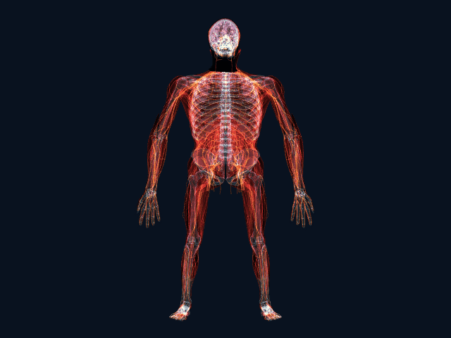

# 3D anatomy camera

[English](README.md) · [**線上使用**](https://3danatomycamera.sportsmedicine.tw/) · [**不開相機先看示範**](https://3danatomycamera.sportsmedicine.tw/#demo) · [版本變更](CHANGELOG.md)

把鏡頭對著自己，3D 骨骼、肌肉與神經會跟著你的頭、手和身體動。這是解剖學習工具，影像只在你的裝置上處理，不會上傳。



在攝影機畫面上探索三大系統：**骨骼與關節、肌肉、神經與感覺器官**。既有器官圖層仍可單獨開啟。使用 Three.js 與 MediaPipe Tasks Vision，所有影像及 landmark 都在瀏覽器內處理；沒有影像上傳、analytics 或第三方執行期請求。

- 網站：<https://3danatomycamera.sportsmedicine.tw/>
- 原始碼：<https://github.com/keanu77/3D_anatomy_camera>（公開 repository）
- 構想受 Hashem Al-Ghaili 的 X-Ray Mirror 啟發，本專案的程式與資料為獨立製作（[原貼文](https://x.com/HashemGhaili/status/2120202746121085321)）。
- 獨立重建與驗證紀錄：`NOTES.rebuild.md`；繪製設計：`NOTES.rendering.md`。

製作：運動醫學科 吳易澄醫師（<https://sportsmedicine.tw/>）。資料來源與授權列在網站的「製作與資料來源」與 `LICENSES/`。

這是解剖教育工具。模型來自參考成人資料，不是使用者的掃描影像，也不代表個人的器官位置或精確關節中心，不用於診斷。

## 開發

需要 Node.js 22.12+；本次使用 Node.js 24。

```sh
npm ci
npm run fetch:models
npm run prepare:assets
npm run dev
```

Vite 提供 HTTPS；使用終端顯示的網址。區網手機必須信任測試憑證才能可靠使用鏡頭；最方便的實機測試方式是開啟上方具有效 HTTPS 憑證的網站。相機只在按下「啟動鏡頭」後開啟。

追蹤模型由官方固定版本下載，與 `public/models/checksums.json` 的預期 SHA-256／大小比對。WASM 從鎖定版本的 npm 套件複製。這些檔案不放入 Git；`npm run build` 會自動下載缺少的固定版本模型並檢查完整性；已通過校驗的本機檔案直接重用。

## 使用

- **先看示範**：不使用相機，也不載入追蹤模型。
- **介面語言**：中文或 English。預設跟隨瀏覽器語言，頁首按鈕可切換（切換會重新載入頁面），連結可用 `?lang=en` 或 `?lang=zh` 指定。英文介面下，構造名稱直接顯示資料來源的英文原名。
- **骨骼與關節／肌肉＋骨骼／神經與感覺器官／三系統一起看**：主要學習預設，三系統合併預設不開啟內臟。
- **Head + hands / Upper body / Full body**：切換圖層預設。身體 JSON、BIN 僅在身體圖層開啟時載入。
- **Body muscles 身體肌肉**：顯示軀幹與四肢肌群，與 **Head muscles** 頭臉肌肉分開控制；Full body 包含兩者。肌肉使用獨立的 JSON、BIN，未開啟時不下載，單獨顯示肌肉也不下載骨骼／器官資料。
- **關節／韌帶肌腱**：椎間盤、肋軟骨、骨間膜、腹股溝韌帶、足底長韌帶與跟腱（阿基里斯腱），並非完整關節軟組織圖譜。來源目前未涵蓋半月板與十字韌帶。
- **神經與感覺器官**：使用原有腦／眼球圖層及新增神經資料。各資料包獨立延遲載入，來源與對位方法詳見 `NOTES.nerve-assets.md`。
- **周邊神經**：臂神經叢、腰薦神經叢與四肢神經、肋間神經、21 條腦神經與三叉神經分支，以及手部的指神經與尺神經深淺支，共 111 個名稱，可點選查看中英文名稱。腦神經隨頭部移動，不隨下巴、眼球或表情變形；手部神經要同時開啟「手部」圖層才會出現，左手顯示的是右手神經的鏡像，且與前臂神經在手腕處不相連（手與身體是分開追蹤的）。資料來自 Z-Anatomy（CC BY-SA 4.0）的手繪曲線，不是影像分割；粗細經放大，關節彎曲時會在關節處斷開。部位聚焦時預設不顯示，勾選「周邊神經」才加入。來源、對位殘差與限制見 `NOTES.peripheral-nerves.md`。
- **X-ray / Solid**：透視或實體表面；可調整真實影像透出、邊緣柔化與切面。
- **點選構造**：啟用後下載精細識別模型；點擊或輕觸單一肌肉、肌頭或骨頭，顯示高亮、中英文名稱與左右側。X-ray 可用選單切換此處重疊的構造；Solid 選取最前方表面。點空白處或「清除」取消選取，關閉點選模式會恢復原始顯示模型。
- **部位聚焦**：選頸部、肩膀、上臂手肘、前臂手腕、胸部、腹部、背部腰部、髖部臀部、大腿膝蓋、小腿腳踝或足部，只顯示該部位的肌肉、骨骼與已收錄的韌帶肌腱，並逐一標出名稱。可選兩側、左側或右側（指使用者自己的左右），並自動放大到該部位。每個部位的成員以來源構造名稱逐項列在 `src/regions.js`；跨關節的肌肉才會出現在相鄰部位，例如髖部包含股直肌與膕旁肌，不含股內外側肌。追蹤仍需要整段身體入鏡（軀幹部位要看得到雙肩與髖部），放大只作用在畫面上。選擇系統或圖層預設會離開聚焦。選部位只會加開該部位需要的圖層並打開名稱標籤，不會關閉已開啟的圖層；例如開著頭骨時選「大腿膝蓋」，頭骨仍會畫出。
- **暫停**：畫面右上「暫停」會凍結鏡頭畫面與模型，方便慢慢點選構造；暫停中仍可切換圖層、部位與外觀，按「繼續」恢復追蹤。停止鏡頭或切換鏡頭會自動解除暫停。
- **旋轉檢視**：暫停後在畫面上拖曳可把模型轉到側面或背面（左右 360 度、上下各 75 度），以目前顯示的構造中心為軸；點一下仍是點選構造，雙擊回正，按「繼續」也會回正。暫停後也可以用雙指開合（或滑鼠滾輪、觸控板縮放手勢）放大畫面，最大 6 倍，以手指中間或游標所在的位置為中心，雙指一起移動可平移；雙擊或按「繼續」還原。放大的是已畫好的畫面，倍率高時會變模糊。轉開後原本蓋在人身上的剪影會改成整張畫面變暗。深度來自姿勢追蹤的估計值，側面看到的前後位置只是近似。
- **Lens**：跟隨食指，沒有手部追蹤時可用滑鼠移動。
- **手機設定**：底部設定抽屜，支援鍵盤焦點、Escape 與橫向畫面。
- **手機快速切換**：接續目前選取的解剖系統循環切換；設定抽屜開啟時，背景控制不會取得鍵盤焦點。
- **切換鏡頭**：先停止舊串流，再啟動另一方向；停止鏡頭會釋放所有 track。
- **效能模式**：自動／高畫質／平衡／輕量。自動模式持續低於 18 fps 時降級；輕量模式以身體為主，手部降為每秒 4 次（也用來核對姿勢是否可信）；使用手指 lens 時只追蹤手部。輕量模式不啟用分割遮罩。

支援的瀏覽器會在本機背景執行緒進行追蹤，讓推論期間的停止按鈕保持可操作；一次只處理一張影格，不累積舊畫面。不支援時保留主執行緒相容路徑。這項改善不代表所有裝置都有相同幀率；實作與限制見 `NOTES.tracking.md`。

點選肌肉、神經或骨骼時，資訊卡會另外顯示英文說明：肌肉的起點、止點、動作、神經與血液供應，神經的來源、分支與支配範圍，骨骼的條目首段與關節面（115 個骨骼名稱都有首段，46 個另有關節面）。內容引自英文維基百科條目的資訊框與首段（CC BY-SA 4.0），未翻譯、未改寫，並附所引條目版本的連結；肌肉的頭或分部顯示整條肌肉的說明，少數構造沒有可用條目而不顯示。這是百科內容，未經臨床審閱。對應表、重建方式與已知的弱項見 `NOTES.structure-info.md`。

精細識別保留原始表面的來源 ID，不以「最近的肌群」猜名稱。肌肉頭／分部會明確標示；左右足背側骨間肌的兩筆來源僅提供肌群集合，仍顯示為群組。少數尚未校對的中文名稱保留來源英文。左手沿用既有右手參考模型鏡像，資訊卡會說明此來源差異。

示範網址同時接受 query 與 hash 參數：

```text
/?still#demo          頭部與手部固定畫面
/#demo&body           全身動畫
/?still#demo&body      全身固定畫面
/?still#demo&bodyMuscles 身體肌肉固定畫面
/?still#demo&nervous   神經與感覺器官固定畫面
/#demo&systems        三大系統合併動畫
/?still&rear#demo      未鏡像的固定畫面
/#demo&focus=shoulder  肩膀聚焦（neck、shoulder、elbow、forearm、chest、abdomen、back、hip、knee、lowerleg、foot）
/#demo&focus=elbow&peripheral  聚焦並加上周邊神經；peripheral 也可單獨與其他參數併用
```

正式版不提供 debug globals、URL 指定程式載入或 dump 注入。Dev diagnostics 透過 `window.__ANATOMY_DIAGNOSTICS__()` 讀取。

## 驗證與建置

```sh
npm run lint
npm test
npm run build
npx playwright install chromium
npm run e2e
```

`npm run e2e` 會啟動 HTTPS 開發站 4173 與套用正式 `_headers` 的產出檔測試站 4174。執行前需要完成 build。報告在 `playwright-report/`，失敗 trace 與畫面在 `test-results/`。

測試包含新版六種畫面快照自我比對、設定白名單、模型格式、幾何基底、鏡頭生命週期、lazy loading、手機版面、body endpoint，以及同源 CSP 下的真實模型執行。手機裝置模擬不等同於 iOS Safari／Android 實機驗收；實機項目與測量結果記錄於 `NOTES.md`。

輸出是純靜態 `dist/`。未壓縮預算為總計 50 MB、排除完整 MediaPipe WASM 目錄後 30 MB；這是修正原計畫不可達成的 25／12 MB 上限。首屏不會下載解剖 binary、WASM 或追蹤模型。

## 部署

本專案使用 Cloudflare Pages Direct Upload。GitHub Actions 自動執行檢查與保存報告；推送不會直接部署。

```sh
BUILD_SHA=$(git rev-parse HEAD) npm run build
wrangler pages deploy dist --project-name 3d-anatomy-camera --branch main
npm run verify:deploy
```

`version.json` 的 `builtAt` 在帶 `BUILD_SHA` 的建置中取該 commit 的提交時間（或 `SOURCE_DATE_EPOCH`），同一個 commit 不論何時重建都得到相同位元組，`verify:deploy` 才能從乾淨 checkout 重現；沒有 `BUILD_SHA` 的本機建置仍記錄當下時間。

部署後核對 `/version.json` 的 commit、HTTP security headers、各 binary／模型 SHA-256 與畫面。`public/_headers` 包含 CSP、Permissions-Policy、Referrer-Policy、nosniff 及禁止 frame embedding。其他靜態主機須自行提供對應 response headers；meta CSP 無法取代 `frame-ancestors` header。

如部署於子路徑，使用 `BASE_PATH=/your-path/ npm run build`，並讓主機正確映射該路徑。模型、WASM 與 anatomy 路徑會使用 Vite base。

## 身體資料重建

網站不需要 Python；只有重建資料時才需要。

```sh
python3 -m venv tools/.venv
tools/.venv/bin/python -m pip install -r tools/requirements-body.txt
tools/.venv/bin/python tools/build_body.py
tools/.venv/bin/python tools/build_body.py --verify --no-previews
tools/.venv/bin/python tools/build_muscles.py
tools/.venv/bin/python tools/build_muscles.py --verify --no-previews
tools/.venv/bin/python tools/build_joints.py
tools/.venv/bin/python tools/build_joints.py --verify --no-previews
tools/.venv/bin/python tools/build_nerves.py
tools/.venv/bin/python tools/build_nerves.py --verify --no-previews
tools/.venv/bin/python tools/build_individual_body.py --verify
tools/.venv/bin/python tools/build_individual_head.py --verify
```

來源固定為 BodyParts3D 3.0 conventional OBJ。18 組 mesh 包含獨立頸椎、軀幹、六組器官、雙側四肢與足部；所有頂點沿用官方表面資料。下載快取在 `tools/cache/`，方向與器官預覽在 `tools/out/`，均不進 Git。來源 hash、FMA、幾何參考點、座標轉換及限制詳見 `body.json` 與 `NOTES.body-assets.md`。

身體肌肉沿用同一版本與解剖座標，另外輸出為 `muscles.json`、`muscles.bin`；覆蓋範圍與來源詳見 `NOTES.muscle-assets.md`。肌肉依身體區段跟隨動作，未模擬收縮或跨關節形變。替代模型與後續改良方向記錄於 `NOTES.model-options.md`。

精細點選使用另外的 `individual-body` 與 `individual-head` 資料包。來源逐構造簡化後才合併，各三角形有明確構造歸屬；一般模式不下載這兩個資料包。格式、對位與實際覆蓋範圍見 `NOTES.picking.md`、`NOTES.individual-body.md`、`NOTES.individual-head.md`。

關節資料另存於 `joints.json`、`joints.bin`：49 個來源部件整理為 15 個區域模型，詳見 `NOTES.joint-assets.md`。肌肉、關節管線皆會檢查既有頭部及骨骼／器官檔案未被修改。

神經資料另存於 `nerves.json`、`nerves.bin`：HRA 的 30 個實際脊髓節段依參考椎管對位後分成 4 區，BodyParts3D 的左右視神經、視交叉與左右視束共 5 個結構則對位至原有頭部座標。脊髓隨軀幹追蹤，視覺神經隨頭部追蹤。這是不同參考資料間的近似對位，沒有全身周邊神經、脊神經根、馬尾或聽覺／前庭器官，詳見 `NOTES.nerve-assets.md`。

## 頭部與手部資料重建

頭手網格直接由同一份 BodyParts3D 3.0 來源重建；頭部對齊固定版本的
MediaPipe 標準臉模，手部座標來自骨頭端面與幾何。請依序執行，避免多個
建置程序同時修改共用的來源雜湊紀錄。

```sh
tools/.venv/bin/python tools/build_head.py --verify
tools/.venv/bin/python tools/build_nerves.py --verify
tools/.venv/bin/python tools/build_individual_head.py --verify
tools/.venv/bin/python tools/build_peripheral_nerves.py --verify --no-previews
```

固定變換、殘差、來源校驗碼與驗收範圍見 `NOTES.rebuild.md`。

## 授權

獨立製作的程式碼採 [MIT](LICENSE)，Copyright (c) 2026 吳易澄。解剖資料、文字與示範圖像依下列來源授權提供，不適用程式碼的 MIT 授權。

BodyParts3D，© The Database Center for Life Science。獨立重建的頭手資料與所選 3.0 身體資料依其來源 CC BY-SA 2.1 Japan 授權；衍生 mesh 保留相同授權與修改紀錄。官方現行資料庫網頁另有更新授權，未在此專案默默改寫舊版來源的明示授權。

HRA 脊髓：Kristen Browne、Heidi Schlehlein，2022，*3D Reference Organ for Spinal Cord, Male, v1.0*，HuBMAP，[DOI:10.48539/HBM366.MTJD.685](https://doi.org/10.48539/HBM366.MTJD.685)，CC BY 4.0。來源、對位與修改說明在 `LICENSES/HRA-spinal-cord.md`；神經資料包逐 mesh 保留不同來源授權。

MediaPipe 標準臉模採 Apache-2.0，固定 commit 與 SHA-256 見 `LICENSES/MediaPipe-canonical-face-model.md`。Three.js 採 MIT，MediaPipe Tasks Vision 採 Apache-2.0。完整 attribution 與授權文件在 `LICENSES/`，建置時同步至網站 `/licenses/`。
